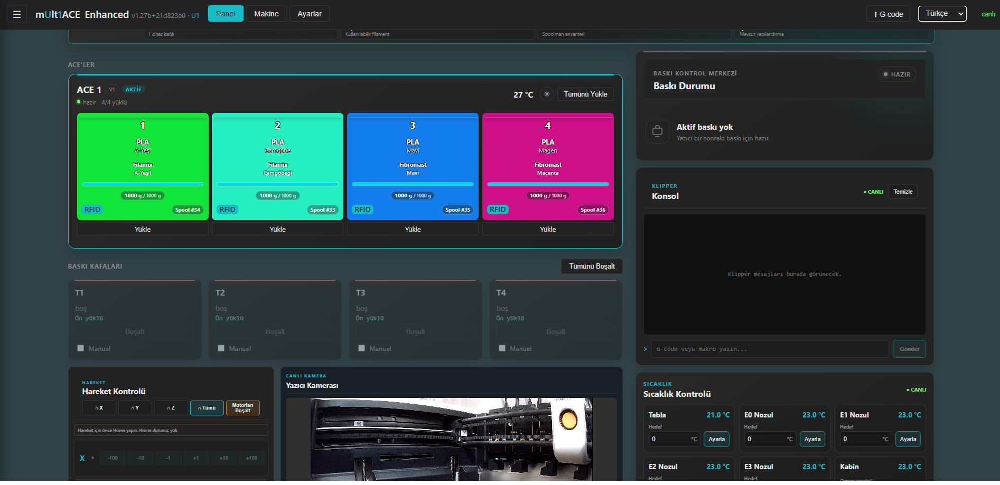

# MultiACE Enhanced — Snapmaker U1

> **PAXX 2.0 public firmware project:** Candidate #49 is built and has passed
> automated/emulated QA, and the **integrated #49 image has now been installed
> on the development Snapmaker U1 after PAXX 1.6**. The operator reports the
> system working. Two post-#49 cold boots and release auditing remain;
> the stable GitHub Release remains an unpublished draft.
> See [release acceptance plan](docs/PAXX20_PUBLIC_RELEASE_GATE.md) and
> [CHANGELOG.md](CHANGELOG.md) and the [2026-11-22 on-device test record](docs/VALIDATION_20261122_BUILD49.md).
> Previous #47 web-hotfix testing is tracked separately from the new #49 installation.

Community-maintained source snapshot and integration work for **Snapmaker U1**, based on **decay71 multiACE** and the **PAXX Extended Firmware** ecosystem.

## Project status

**Source-review / development snapshot — not a one-click installer or an official PAXX package.**

The development printer runs **PAXX 2.0.0-paxx12-24-417e639** with a **multiACE 1.27b** engine. The project documents verified local improvements and aims to contribute reviewable changes upstream.

**PAXX 2.1.0 managed multiACE has not been validated with this Enhanced installation.** Do not apply these files directly to a different firmware version.

**2026-11-12 printer validation update:** Enhanced Web and all four locales survived cold boot, the guarded restore boot hook ran with `APPLY_OK`, and V3.1 full recovery archive creation passed strict manifest verification (9,517 files). See [2026-11-12 validation and recovery hash](docs/VALIDATION_20261112.md). Auto Replenish's final four-file active promotion still requires a *subsequent* cold-boot acceptance check; the archive has not been restore-tested.

**PAXX 2.1 readiness:** See the [guarded migration plan](docs/PAXX21_MIGRATION_READINESS.md). The rolling managed multiACE profile is not a direct drop-in upgrade for our standalone Enhanced installation; firmware flashing remains blocked pending a specific-build compatibility and rollback review.

## Work areas

- **Auto Replenish:** a narrow feeder-state exception to support replenishment during a print.
- **Tool changes / TTC:** investigated printer-side timing and tool-change reliability.
- **RFID and Spoolman:** Gen1 ACE tag handling, inventory integration and Web display behavior.
- **Enhanced Web:** backend API additions, frontend changes and translations.
- **Persistence and recovery:** hash-aware startup restoration, compatibility checks and a PAXX 2.0 recovery standard.
- **Field evidence:** prior 11/11 print-start testing and cold-boot persistence checks on the development device.

## MultiACE Enhanced Web — interface preview

The following screenshot shows the live **ACE Pro Gen1 (V1) filament panel** of our Enhanced Web application, including RFID identification, Spoolman-linked spools and U1 toolhead preload status.

*Screenshot from the development printer, November 2026. This is the ACE/filament-management section, not the entire Web application.*

## Source layout

| Directory | Contents |
|---|---|
| `klipper/` | Selected live MultiACE/Klipper modules and printer integration |
| `multiace_web/` | Enhanced backend, frontend and translations |
| `firmware/` | PAXX 2.0 build identification and selected service scripts |
| `recovery/` | Existing persistence and recovery scripts for code review |
| `scripts/` | Compatibility helper |
| `tests/` | Offline snapshot syntax and SHA256 verification |
| `docs/` | Provenance, test evidence, compatibility notes and technical handoff |

Source files are snapshots from an already configured device. They are **not** sufficient to rebuild or install a fully configured system on another printer. See [Source manifest](docs/SOURCE_MANIFEST.md), [field validation](docs/VALIDATION_20261111.md), and the [PAXX technical brief](docs/PAXX_TECHNICAL_BRIEF.md).

## Android RFID NFC Writer — development APK

An accompanying Android NFC/RFID writer build for the **ACE Pro Gen1 / V1** setup is available as a separate **pre-release**:

- [Android RFID NFC Writer v1.1.0-beta — Turkish / English](../../releases/tag/android-rfid-20261106-preview)
- Artifact: `app-debug.apk` (updated 2026-11-11; debug build for testing and technical review only)

The Android application was developed to write filament tag metadata for testing with the existing MultiACE Enhanced / Spoolman setup. v1.1.0-beta adds Turkish and English interface localization, with automatic language selection based on the Android device locale. Our physical testing uses **one Gen1 ACE Pro**. **This APK is not a signed production release**, and the Android application source code is **not yet included** in this repository. The APK should not be mistaken for a ready-to-install MultiACE firmware package.

## Contributing upstream

The intended workflow is to isolate and review individual improvements for **decay71/multiACE** and PAXX, with particular attention to the small Auto Replenish behavior change. A monolithic merge is not assumed.

## Acknowledgements

Special thanks to **PAXX**, **decay71**, and **donkie** for their contributions to the open-source U1 and filament-management ecosystem.

- [PAXX Extended Firmware](https://github.com/paxx12-snapmaker-u1/SnapmakerU1-Extended-Firmware)
- [decay71/multiACE](https://github.com/decay71/multiACE)
- [Spoolman](https://github.com/Donkie/Spoolman)

See [CREDITS.md](CREDITS.md) for full acknowledgement. This is an independent community effort, not an official or endorsed PAXX/decay71 release.

## License

This repository contains the **GNU General Public License v3.0** in [LICENSE](LICENSE). Preserve applicable upstream copyright notices and any component-specific licensing terms when reusing or distributing modifications.

## Safety of this snapshot

Avoid executing the recovery and initialization scripts on an unverified target. Hardware-dependent behavior, dependencies and rollback on a clean installation have **not** been independently verified.
